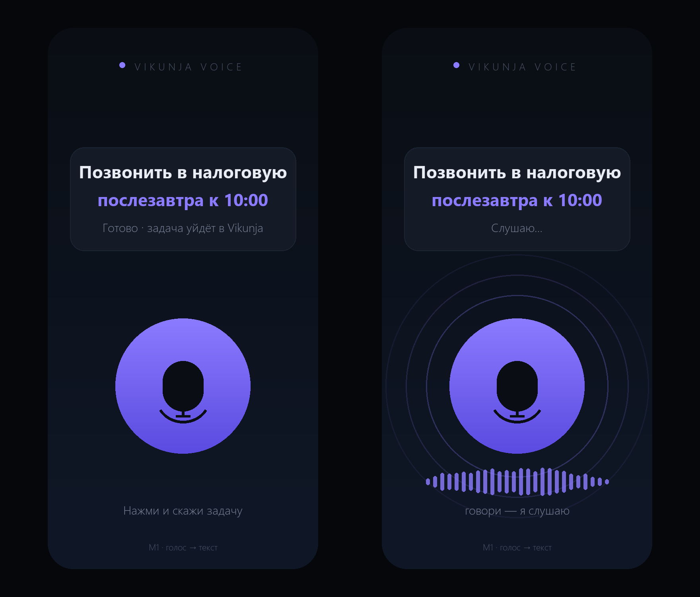

# Vikunja Voice

Android-приложение: **говоришь задачу голосом — она появляется в [Vikunja](https://vikunja.io)**.



## Как работает

1. При первом запуске — экран подключения: адрес сервера Vikunja + API-токен.
2. Приложение получает список проектов через `GET /api/v1/projects`, выбираешь нужный.
3. Дальше — экран «Голос»: нажимаешь и держишь кнопку, говоришь, текст распознаётся
   и уходит задачей в выбранный проект (`PUT /api/v1/projects/{id}/tasks`).
4. Второй экран «Задачи»: список задач проекта; тап по строке — выполнено/не выполнено,
   «×» — удалить с подтверждением. Смена проекта — тап по чипу сверху.
   Выполненные по умолчанию скрыты; переключатель «Показывать выполненные» запоминается.

Распознавание речи — системное Android (`SpeechRecognizer`, `ru-RU`), озвучка ответов не нужна.
План развития (даты из фразы через локальную LLM, офлайн-распознавание, виджет) — в [PLAN.md](PLAN.md).

## Скачать

Готовый подписанный APK — в [Releases](https://github.com/glukogenerator-hue/vikunja-voice/releases).

Релиз подписан отдельным ключом (`keystore.properties`, в git не попадает), поэтому установить
его поверх debug-сборки нельзя — сначала удали debug-версию (настройки сервера/токена сбросятся).

## Релизы

Тег `v*` запускает GitHub Actions: сборка подписанного APK и публикация релиза.

```bash
git tag v0.14
git push origin v0.14
```

Подпись берётся из секретов репозитория: `KEYSTORE_BASE64`, `KEYSTORE_PASSWORD`,
`KEY_ALIAS`, `KEY_PASSWORD` (см. `.github/workflows/release.yml`).

## Сборка

Нужны JDK 17 и Android SDK (platform 34, build-tools 34.0.0). Android Studio не обязателен:

```bash
export JAVA_HOME=/path/to/jdk-17
/path/to/gradle-8.6/bin/gradle assembleDebug
```

APK появится в `app/build/outputs/apk/debug/app-debug.apk`.

## Стек

Kotlin · Jetpack Compose (Material 3) · OkHttp · coroutines · SharedPreferences.
minSdk 26, targetSdk 34.

## API Vikunja: особенности

- Задача создаётся **методом PUT**, `POST` возвращает 405.
- В списке проектов приходят виртуальные пункты с отрицательными id
  (Favorites, Приоритетные задачи) — приложение их фильтрует.
- Токен создаётся в Vikunja: Settings → API Tokens (scopes: Projects read, Tasks create).

Проверка API из консоли:

```bash
VIKUNJA_TOKEN=tk_... python tools/check_api.py
```

## Дизайн

Философия и палитра — [design/DESIGN.md](design/DESIGN.md), генератор мокапа — `design/make_mockup.py`.
